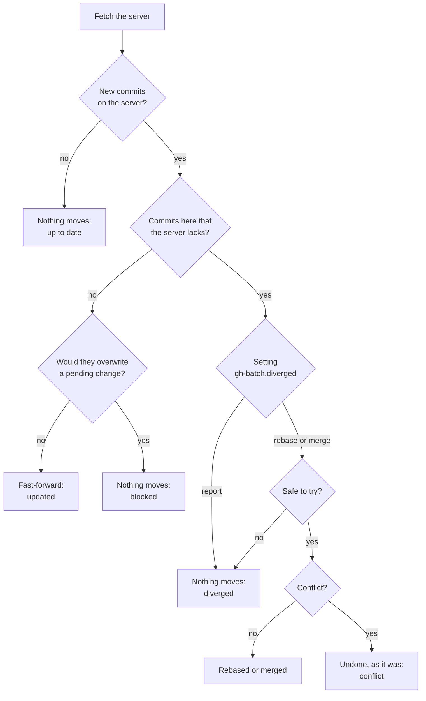
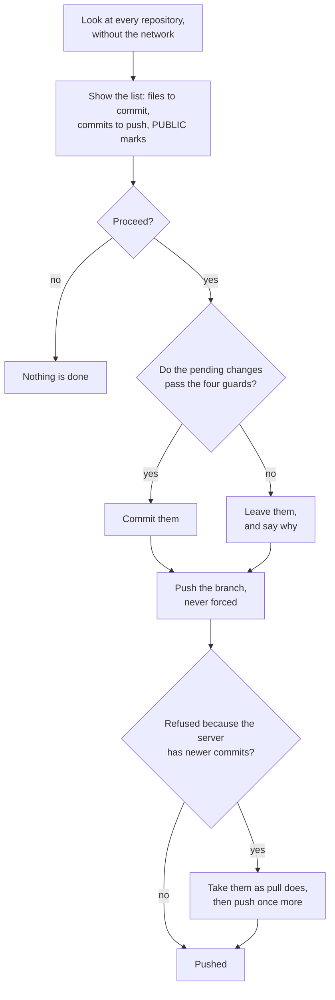

<!-- Author: Dr. Denys Dutykh (Mathematics Department, Khalifa University of Science and Technology, Abu Dhabi, UAE). -->

# gh-batch

Whoever keeps their work in many git repositories, on more than one machine, repeats the same gestures every day: in the morning each project must be brought up to date, in the evening each one must be pushed, and a project created on one machine must be cloned on the others. The tool `gh-batch` does this for a whole folder of repositories with one command. It goes over the folders, finds the git repositories, handles several of them at a time, and prints one line for each repository that changed or that needs you.

It is careful by construction. A conflict is never left inside a repository: the attempt is undone, the repository is exactly as it was, and you are told which files conflict. A push is never forced. Nothing is committed unless you asked for it, and before the evening run commits or pushes anything it shows the full list and waits for one confirmation.

The tool is one bash file. It needs bash 3.2 or newer and git 2.30 or newer, and it runs on Linux and macOS. The GitHub CLI `gh` is optional: it is used to clone a whole account with its organisations, to mark the public repositories, and for one part of the health check.

The repository is at

https://github.com/dutykh/gh-batch

## A day with gh-batch

**In the morning** one command fetches every repository and brings it forward. What arrived is listed, and the two repositories that could not be updated safely are named with the reason. Here the setting `gh-batch.diverged` is `rebase`, so that the commits made on this machine are replayed after the new ones of the server; by default they are only reported.

```text
$ gh-batch pull
gh-batch pull: 7 repositories under ~/workspace

  updated       lecture-notes       main     3 new commits
        c801050 Add the fourth exercise sheet
        2bd2d46 Add the lecture on the group velocity
        01ca9d9 Add the lecture on the dispersion relation
  blocked       paper-solitons      main     1 new commit on the server would overwrite your changes in notes.txt: nothing was changed
  updated       teaching/exam-2026  main     1 new commit
        fdbfc87 Add the third question
  rebased       thesis              main     your 1 commit replayed on top of 2 new ones
        fb867f8 Add two references
        62de4fc Write the existence proof of chapter 2
  ahead         wave-solver         main     1 commit to push
  conflict      website             main     1 commit here and 1 on the server, and they conflict in notes.txt: nothing was changed, the rebase is yours (git pull --rebase)

7 repositories: 2 updated, 1 rebased, 1 up to date, 1 with commits to push, 1 in conflict, 1 blocked.
Needs you: paper-solitons (blocked), website (conflict).
```

**In the evening** one command shows what it is about to do, waits for Enter, then commits what is pending and pushes. Here the automatic commit was asked for with `--commit`; it can also be made the rule with a setting.

```text
$ gh-batch push --commit
gh-batch push: 7 repositories under ~/workspace

Plan:
  not committed lecture-notes       main     1 changed, 1 new: the new file .env looks like a secret: commit it by hand, or add it to .gitignore
  to do         teaching/exam-2026  main     commit 1 file, then push 1 commit
        new      solutions.md
  to do         thesis              main     commit 3 files, then push 1 commit
        changed  notes.txt
        new      abstract.tex
        new      figures/energy.pdf
  to do         wave-solver         main     push 2 commits  [PUBLIC]

To do: a commit in 2 repositories, then a push from 3 repositories, 1 of them PUBLIC.
Proceed? [Y/n]

Done:
  not committed lecture-notes       main     1 changed, 1 new: the new file .env looks like a secret: commit it by hand, or add it to .gitignore
  local only    scratch             main     it has no remote: it exists on this machine only
  pushed        teaching/exam-2026  main     committed 1 file, pushed 1 commit after taking 1 commit from the server
  pushed        thesis              main     committed 3 files, pushed 1 commit
  pushed        wave-solver         main     pushed 2 commits  [PUBLIC]

7 repositories: 3 pushed, 2 with nothing to push, 1 without remote, 1 not committed.
Needs you: lecture-notes (not committed).
```

**In the middle of the day**, before leaving one machine for another, `gh-batch sync` does both in one run. **On a new machine**, or the day after a project was created elsewhere, `gh-batch clone` brings what is missing:

```text
$ gh-batch clone
gh-batch clone: 5 repositories of ada on GitHub; 2 already under ~/workspace, 3 to clone

Plan: clone 3 repositories into ~/workspace (about 55 MB)
  lecture-notes   private  51 MB
  paper-solitons  PUBLIC   3 MB
  website         private  under 1 MB
Proceed? [Y/n]

  cloned        lecture-notes   main     into ~/workspace/lecture-notes
  cloned        paper-solitons  main     into ~/workspace/paper-solitons
  cloned        website         main     into ~/workspace/website

3 repositories: 3 cloned.
```

The organisations that the account belongs to are read with it, and the repositories of each go to a folder of their own, which is asked for once.

## Installation

There are three ways, and they can coexist.

As an extension of the GitHub CLI, which then keeps it up to date with `gh extension upgrade batch`. The commands are typed `gh batch pull`, `gh batch push`, and so on; everywhere below, read `gh batch` for `gh-batch`.

```bash
gh extension install dutykh/gh-batch
```

With the installer, which copies the program into `~/.local/bin` and installs the completion for bash and zsh:

```bash
curl -fsSL https://raw.githubusercontent.com/dutykh/gh-batch/main/install.sh | bash
```

From a clone of the repository, linked instead of copied, so that a `git pull` of the clone (which `gh-batch pull` itself performs each morning, if the clone sits among your repositories) updates the command:

```bash
git clone https://github.com/dutykh/gh-batch
gh-batch/install.sh --link
```

The installer accepts `--prefix DIR` for another place than `~/.local`, `--no-completion`, and `--uninstall`. Since the tool is a single file, copying `gh-batch` anywhere on the `PATH` is an installation too.

Then tell it once where your repositories live, and look at them:

```bash
git config --global gh-batch.root ~/workspace
gh-batch status
```

Without that setting, every command works on the folders named on its command line, or on the current folder.

## The commands

| Command | What it does |
|---|---|
| `pull` | Fetch every repository and bring it forward. |
| `push` | Push every repository that has new commits, after committing what is pending when asked to. |
| `sync` | Pull, then push. |
| `clone` | Clone what is missing: a whole GitHub account with its organisations, or the entries of a layout file. |
| `status` | Show what is pending in every repository, without touching the network. |
| `fetch` | Look at the servers, change no file, say what `pull` would do. |
| `log` | List the commits of today, or of a period, across the repositories. |
| `exec` | Run a command in every repository. |
| `doctor` | Examine the repositories, their remotes and the folder around them. |
| `list` | Print the repositories found, or their layout. |
| `config` | Print the settings in force and where each comes from. |
| `completion` | Print the completion script for bash or zsh. |
| `help` | Print the help of one command: `gh-batch help push`. |

Every command takes folders as arguments. A folder is searched for repositories three levels deep (`--depth N` changes that); a folder that holds `.git` is a repository and is not searched further, so a repository nested inside another one is left to its parent. Hidden folders and `node_modules` are not entered. The options common to all commands are these.

| Option | Meaning |
|---|---|
| `-j N`, `--jobs N` | Repositories handled at the same time; 8 by default, and 1 means strictly one after the other. The report always follows the order of the folders. |
| `--depth N` | Levels searched below each folder (3). |
| `--only GLOB`, `--except GLOB` | Keep, or leave out, the repositories whose name matches; both can be repeated. |
| `-n`, `--dry-run` | Show what would be done and change nothing. |
| `-y`, `--yes` | Do not ask before committing, pushing or cloning. |
| `-v`, `--verbose` | Show every repository, not only those that changed. |
| `-q`, `--quiet` | Show only what needs you. |
| `--porcelain` | One line per repository, with fields separated by tabs. |
| `--timeout SEC` | Give up on a server that does not answer (300). |
| `--color WHEN` | `auto`, `always` or `never`; `NO_COLOR` is honoured. |

### pull

For each repository the branch that is checked out is compared with the branch it follows on the server, and one of five things happens.



When only the server has new commits, the branch is moved forward. Files with uncommitted changes that the new commits do not touch stay as they are. If they would be touched, or if an untracked or ignored file stands where a new file must be written, git refuses, nothing changes, and the repository is reported as blocked with the names of the files. A file deleted here without a commit is the one exception, because git does not count a missing file as a change it could overwrite: when the new commits change it, it comes back in its new version, and the report names it.

When both sides have new commits, the setting `gh-batch.diverged` decides. With `report`, the default, nothing is tried. With `rebase`, your commits are replayed on top of those of the server; with `merge`, the two histories are joined by a merge commit. At the first conflict the attempt is undone at once, the tool verifies that the commit, the branch and every pending change are what they were, and the conflicting files are named together with the command to run by hand.

A replay is tried only when it is safe. It is refused, and the repository reported as diverged with the reason, when a tracked file has uncommitted changes, when a merge commit is among your commits, when some of them are already on a server, when the history of the server was rewritten, when the commits are signed (signing them again could ask for a passphrase), when the clone is shallow, or when a file that the server added exists here untracked or ignored.

A detached HEAD, an operation left in progress, a branch that no longer exists on the server and a repository without remote are reported and left alone. The command `gh-batch pull --dry-run` fetches and only says what would be done; it is the same as `gh-batch fetch`.

### push

The push works in two passes. The first one, local and fast, works out for every repository the files to commit and the commits to push. Their list is shown, the public repositories are marked `PUBLIC` when `gh` is installed, and one confirmation is asked. The second pass commits and pushes. Without a terminal there is nobody to ask, so the run refuses to act unless `--yes` is given.



**The automatic commit** is off by default: pending changes are then only reported, as what stays on this machine. With `--commit`, or with `git config --global gh-batch.commit true`, every pending change of every repository is committed first: files modified, deleted or new, the ignored ones excepted. The message is `Work in progress, DATE (MACHINE)`, followed by the list of the files; `-m TEXT` or the setting `gh-batch.message` gives another first line, in which `%d` is the date, `%t` the time, `%h` the machine and `%n` the number of files.

Four guards leave a repository uncommitted and name it in the report: a new file whose name suggests a secret (`.env`, a private key, a credentials file, and the like), a file above `gh-batch.maxFileSize` (50 MB), more new files at once than `gh-batch.maxNewFiles` (200, the sign of a missing `.gitignore`), and a folder that is a git repository of its own and is not ignored. The commits that already exist are still pushed. When a commit is refused, by a hook for instance, the staging area is put back exactly as it was.

A repository opts out for good with `git config gh-batch.commit false`, typed inside it: neither the option nor the general setting overrides that. With `git config gh-batch.pullOnly true` a repository is neither committed nor pushed, which suits the clone of somebody else's project.

**The push itself** sends the branch where `git push` would send it and never forces. A branch that exists on this machine only is reported, and published only with `--set-upstream`. Only the branch that is checked out is pushed; another local branch with unpushed commits is named in the report. When GitHub answers that the account has no right to push, or that the repository is archived, nothing is tried.

**When the server has newer commits**, they are first taken exactly as `pull` would take them, under the same setting `gh-batch.diverged`, and the push is tried once more. A conflict on the way is undone and reported, and the commit just made stays on this machine. With the default setting `report`, a repository whose last fetch already showed such commits is neither committed nor pushed, since the push would be refused: the plan names it, and `gh-batch sync`, which pulls first, is the command for it.

### sync

The command `gh-batch sync` runs the pull, prints its summary, then runs the push with its list and its confirmation. It accepts the options of both.

### clone

In its first form the list comes from GitHub, through `gh`: every repository of the account that `gh` is logged in to and of the organisations it belongs to, or of the owners named on the command line (accounts or organisations).

```bash
gh-batch clone                      # what is missing of your account and of its organisations
gh-batch clone --no-orgs            # of your account alone
gh-batch clone my-organisation      # of one owner alone, account or organisation
gh-batch clone --since 2026-01-01   # only what was pushed this year
gh-batch clone --update             # and pull what is present already
```

A repository counts as present when one of the clones under the destination has it as a remote, whatever the name and the depth of its folder, and also when it was renamed or transferred on GitHub since. The missing ones go to `DEST/name` for the account itself and to `DEST/folder/name` for any other owner; `--flat` puts every owner at the top, and `--by-owner` gives the account a folder too. The destination is `--into DIR`, else the folder of `gh-batch.root`; a mass clone never falls back on the current folder. The filters are `--only GLOB`, `--except GLOB`, `--since DATE`, `--no-forks` and `--no-archived`.

**The folder of an organisation** is asked for once. The first time an organisation of the account has something to clone, the tool proposes a folder, the one where clones of that organisation already are, else its name on GitHub, and waits: Enter takes it, another name replaces it, and a minus sign leaves the organisation out. The answer is kept in git's configuration, so the question does not return.

```text
$ gh-batch clone
3 repositories of the organisation Hydrodynamics Laboratory (hydro-lab) are missing here.
Folder for the organisation under ~/workspace [hydro-lab], or - to leave it out: lab
(kept: git config --global gh-batch.hydro-lab.folder lab)

gh-batch clone: 8 repositories of ada and hydro-lab on GitHub; 5 already under ~/workspace, 3 to clone

Plan: clone 3 repositories into ~/workspace (about 14 MB)
  lab/flume-data      private  12 MB
  lab/group-meetings  private  under 1 MB
  lab/wave-tank       PUBLIC   2 MB
Proceed? [Y/n]
```

The same choices can be typed by hand: `gh-batch.OWNER.folder NAME` names the folder of an owner, and holds also when that owner is named on the command line; `gh-batch.OWNER.skip true` leaves an organisation out until it is named. A folder is a path below the destination, no deeper than the other commands search (`a/b` at most with the default depth of three), and a dot stands for the destination itself. With `--yes`, with `--dry-run` or without a terminal nothing is asked and the folder proposed is taken. The setting `gh-batch.orgs false` keeps `clone` to the account alone, as `--no-orgs` does for one run. An organisation that GitHub refuses to list is named in the report and does not stop the others.

Four repositories are cloned at a time. Each clone is made under a temporary name beside its place and renamed when it is complete, so an interrupted run leaves nothing half-made, and the leftover of a run that died is removed by the next one. A folder that exists and is not the repository is never touched: it is named in the report. Large files kept with git-lfs are downloaded in a second step, so that a failed download cannot lose the clone.

In its second form the list is a layout file. On one machine, `gh-batch list --manifest` writes one line per repository with its folder, its address and its branch; on another, `gh-batch clone --manifest FILE` clones the missing ones into the same folders, on the same branches. This form needs no `gh` and works with any git server.

```text
$ gh-batch list --manifest
# Layout of ~/workspace, written by gh-batch list --manifest.
# One repository per line: folder, address, branch, separated by tabs.
# "gh-batch clone --manifest FILE" clones the missing ones into the same folders.
lecture-notes	https://github.com/ada/lecture-notes	main
paper-solitons	https://github.com/ada/paper-solitons	main
thesis	https://github.com/ada/thesis	main
wave-solver	https://github.com/ada/wave-solver	main
website	https://github.com/ada/website	main
```

### status and fetch

The command `status` uses no network. It shows what is pending and since when: files changed or new, commits to push, commits behind the last fetch, stashes, an operation left in progress. With `--long` the pending files are listed.

```text
$ gh-batch status
gh-batch status: 7 repositories under ~/workspace

  pending       lecture-notes       main     1 changed, 1 new (the oldest since 0 min)
  local only    scratch             main     no remote: it exists on this machine only
  pending       teaching/exam-2026  main     1 new (the oldest since 0 min)
  pending       thesis              main     1 changed, 2 new (the oldest since 0 min)
  ahead         wave-solver         main     2 commits to push (the oldest since 0 min)

7 repositories: 2 clean, 3 with pending changes, 1 with commits to push, 1 without remote.
```

The command `fetch` asks the servers and says what `pull` would do, without touching a branch or a file.

### log

The command `log` answers the question of the evening, or of the weekly report: what did I do? Without an option it lists your commits of today on every local branch, each repository with its commits in the order they were made.

```text
$ gh-batch log
  commits       scratch             main     1 commit
        13:42  d27d145  First try
  commits       teaching/exam-2026  main     2 commits
        13:42  b87e3c1  Add the third question
        13:42  3f0bd89  Work in progress, 2026-11-13 (office)
  commits       thesis              main     1 commit
        13:42  c255063  Work in progress, 2026-11-13 (office)
  commits       wave-solver         main     2 commits
        13:42  386a3db  Add the time stepper
        13:42  4ff7be0  Test the time stepper

6 commits in 4 repositories today (7 searched under ~/workspace).
```

The period is set with `--since` and `--until`, in any form git reads (`yesterday`, `monday`, `"2 weeks ago"`, `2026-11-01`). "Yours" means the address that git uses in each repository (`user.email`); `--author TEXT` selects another author and `--all-authors` everybody. A long first line is cut at 100 characters and a repository shows at most 50 commits, unless `--long` is given. With `--porcelain` each commit is one line: the time in seconds, the path, the short hash, the author and the subject.

### exec

The command `exec` runs anything in every repository, several at a time, and prints what it wrote under the name of each repository. The command starts at `--`, or at the first word that is not an option, and keeps the rest of the line. It runs in the top folder of the repository, without a terminal, with `GH_BATCH_REPO` (the path) and `GH_BATCH_NAME` (the name) in its environment.

```bash
gh-batch exec git gc --quiet
gh-batch exec --dirty -- git status --short
gh-batch exec --in ~/papers -- sh -c 'ls *.tex 2>/dev/null | wc -l'
```

The options `--dirty`, `--clean`, `--ahead` and `--behind` keep only the repositories in that state. Because the command starts at the first plain word, a folder is given here with `--in DIR`. A repository where the command succeeded and wrote nothing is only counted, and the exit status is 1 when it failed somewhere.

### doctor

The command `doctor` changes nothing and names what is wrong, or will be.

```text
$ gh-batch doctor
gh-batch doctor: 4 repositories under ~/workspace

  warning       old-course    main     1 warning
        warning: the remote origin moved on GitHub to teaching/course-2024: git remote set-url origin https://github.com/teaching/course-2024
  warning       scratch       main     1 warning
        warning: no remote: the repository exists on this machine only
  warning       thesis        main     1 warning
        warning: 1 stash: what is stashed stays on this machine
  warning       wave-solver   main     1 warning
        warning: ada/wave-solver is archived on GitHub: it takes no push

Around the repositories:
  warning: the folder ~/workspace/drafts holds no git repository within 3 levels: git saves nothing of it

4 repositories: 4 with warnings.
```

A problem makes the exit status 1: an operation left in progress, unresolved conflicts, a branch whose upstream is gone, a password or a token written in the address of a remote (it is never printed), a repository that GitHub does not know, a folder that git refuses to read. A warning does not: no remote, a detached HEAD, a branch that follows nothing, pending changes or unpushed commits older than a week (`--days N`), stashes, a remote renamed or transferred on GitHub (with the command that corrects its address), an archived repository, git-lfs needed and missing. Around the repositories it names the folders that hold no repository, the loose files and the leftovers of an interrupted clone. GitHub is asked through `gh`, one question per repository; `--offline` leaves those questions out.

### list, config, completion

The command `list` prints the names of the repositories found, their full paths with `--absolute`, or their layout with `--manifest`. The command `config` prints every setting with its value and its source. The command `completion bash` or `completion zsh` prints the completion script, which the installer puts in place.

## What gh-batch never does

It never forces a push, never deletes a branch or a file of yours, never resets a repository, never cleans a working tree, never drops a stash and never skips a hook. It never leaves a conflict, a half-finished rebase or a half-finished merge behind. It never commits unless the option or the setting says so, and then never a repository that opted out. It never pushes a branch onto a branch of another name unless git itself was configured to do so. It never asks a question in the middle of a run: git is run so that a missing password is an error, not a prompt, and its own questions, the folder of an organisation met for the first time and the one confirmation, come before anything is changed. A test of the suite reads the source and fails if a forced push, a hard reset or a cleaning command ever appears in it.

## Settings

The settings live in git's own configuration, so there is no new file to learn. A setting is changed with `git config --global gh-batch.NAME VALUE`, and `gh-batch config` shows them all.

| Setting | Default | Meaning |
|---|---|---|
| `gh-batch.root` | the current folder | The folder searched when none is named; it may be given several times. |
| `gh-batch.depth` | 3 | Levels searched below each folder. |
| `gh-batch.jobs` | 8 | Repositories handled at the same time. |
| `gh-batch.timeout` | 300 | Seconds after which a silent server is given up. |
| `gh-batch.diverged` | `report` | What `pull` does when both sides have commits: `report`, `rebase` or `merge`. |
| `gh-batch.commit` | `false` | Commit pending changes before the push. |
| `gh-batch.confirm` | `true` | Ask once before committing, pushing or cloning. |
| `gh-batch.message` | `Work in progress, %d (%h)` | First line of the automatic commits. |
| `gh-batch.machine` | the name of the host | The machine named in those commits. |
| `gh-batch.maxFileSize` | 50 | Megabytes above which a file stops the automatic commit; 0 for no limit. |
| `gh-batch.maxNewFiles` | 200 | New files at once above which the automatic commit stops; 0 for no limit. |
| `gh-batch.exclude` | none | A pattern of names to leave out of every command; it may be given several times. |
| `gh-batch.notify` | none | A command that receives the report on its standard input. |
| `gh-batch.notifyOn` | `never` | When to send it: `never`, `attention` or `always`. |
| `gh-batch.orgs` | `true` | Whether `clone` reads the organisations of the account too. |

Two settings concern one owner on GitHub, an account or an organisation, whose name stands in the middle of the key; `clone` writes them when it has asked, and they can be typed by hand.

| Setting | Meaning |
|---|---|
| `gh-batch.OWNER.folder NAME` | The folder below the destination where `clone` puts the repositories of that owner; a dot for the destination itself. |
| `gh-batch.OWNER.skip true` | `clone` leaves that organisation out, unless it is named on the command line. |

Three settings belong inside a repository, where they are typed without `--global`.

| Setting | Meaning |
|---|---|
| `gh-batch.skip true` | No command touches the repository. |
| `gh-batch.pullOnly true` | It is updated, never committed or pushed. |
| `gh-batch.commit false` | It is never committed automatically, whatever the option or the general setting. |

The command line wins over the environment, which wins over the configuration. The environment variables are `GH_BATCH_ROOT`, `GH_BATCH_JOBS`, `GH_BATCH_DEPTH`, `GH_BATCH_TIMEOUT`, `GH_BATCH_DIVERGED`, `GH_BATCH_COMMIT`, `GH_BATCH_CONFIRM`, `GH_BATCH_ORGS`, `GH_BATCH_MESSAGE`, `GH_BATCH_MACHINE`, `GH_BATCH_MAX_FILE_SIZE`, `GH_BATCH_MAX_NEW_FILES`, `GH_BATCH_NOTIFY` and `GH_BATCH_NOTIFY_ON`.

## Reading the report

A report has one line per repository that changed or needs you, in the order of the folders, then one summary line, then the list of those that need you. The repositories where nothing happened are only counted; `--verbose` shows them, and `--quiet` shows nothing but what needs you.

| Word | Meaning |
|---|---|
| `updated`, `rebased`, `merged` | The branch was brought forward by `pull`. |
| `up to date`, `clean`, `nothing` | Nothing to do. |
| `ahead`, `behind`, `pending`, `stash` | Commits to push, commits to pull, uncommitted changes, stashes. |
| `pushed`, `cloned`, `to do` | Done by `push` or `clone`, or about to be done. |
| `blocked` | New commits wait on the server, and taking them would overwrite a change here. |
| `diverged` | Both sides have commits, and they were not reconciled. |
| `conflict` | A rebase or a merge was tried, conflicted, and was undone. |
| `rejected`, `failed` | The server refused the push; a fetch, a push or a clone failed. |
| `not committed` | A guard stopped the automatic commit. |
| `local only`, `no upstream`, `detached`, `gone` | No remote; a branch that follows nothing; no branch; a branch that left the server. |
| `unfinished`, `busy` | An operation is in progress; another git process holds the index. |
| `skipped`, `unreadable` | Set aside by a setting; git cannot read the folder. |

On a terminal every line carries a sign and a colour: a green tick for what was done, a faint dot for nothing to do, yellow arrows and dots for what waits (commits to push, commits to pull, pending changes), a red cross for what needs you; the names are in bold, the branches in cyan, the commits in the yellow of git, and a run of some length says how long it took. The colours are the sixteen of the terminal, so they follow its theme. A report written to a pipe or handed to a command stays plain, `--color never` and the variable `NO_COLOR` turn the colours off, and a terminal that is not UTF-8 gets letters in place of the signs.

The exit status is 0 when nothing needs you, 1 when at least one repository needs you, 2 for a bad invocation, 3 when git or `gh` is missing or another `gh-batch` is at work, and 130 when the run was stopped by a signal. With `--porcelain` each repository is one line of four fields separated by tabs: the state, the path, the branch and the message.

Every move of a branch is recorded with its date in `~/.local/state/gh-batch/journal.tsv`: the fast-forwards, the rebases, the commits and the pushes, with the commits before and after. The same folder keeps the date of the last pull and of the last push, which `status` shows.

## Runs that nobody watches

A run started by a timer has no terminal, so it tells its result through a command of your choice. That command receives the report on its standard input, and finds the name of the command in `GH_BATCH_COMMAND` and `ok` or `attention` in `GH_BATCH_STATUS`.

```bash
git config --global gh-batch.notify 'tg-ping --title "Repositories"'
git config --global gh-batch.notifyOn attention
```

Here the report goes to Telegram through [tg-ping](https://github.com/dutykh/tg-ping), and only when a repository needs you; `notify-send gh-batch "$(cat)"` would show it on the desktop, and `mail -s gh-batch you@example.org` would send it by mail. The option `--notify` sends the report of one run whatever the setting.

With systemd, two small files in `~/.config/systemd/user/` run the morning update on working days at half past seven. The exit status 1 means that a repository needs you, which is not a failure of the service.

```ini
# gh-batch-pull.service
[Unit]
Description=Morning update of the git repositories

[Service]
Type=oneshot
ExecStart=%h/.local/bin/gh-batch pull --notify
SuccessExitStatus=1
```

```ini
# gh-batch-pull.timer
[Unit]
Description=Morning update of the git repositories, on working days

[Timer]
OnCalendar=Mon..Fri 07:30
Persistent=true

[Install]
WantedBy=timers.target
```

```bash
systemctl --user enable --now gh-batch-pull.timer
```

Such a run needs credentials that git finds without asking: a credential helper for HTTPS, or an ssh agent whose socket the service can see. An evening push by a timer needs `--yes`, and deserves a thought: it would commit and publish whatever is in the folders at that hour.

## How it works

The repositories found are shared among a few workers. Each worker claims the next free repository, handles it, and writes its result to a file; the main program prints the results in the order of the folders as they become available. One job or eight give the same report.

Every long step (a fetch, a push, a clone, a merge, a rebase, a commit) runs in a process group of its own. An interrupt from the keyboard therefore reaches the tool and not the step: the tool ends the network steps at once, since stopping them is harmless, and lets a step that is moving files finish, so that Ctrl-C never leaves a working tree half-updated. A second Ctrl-C stops everything at once. Each network step has a deadline, and a step that stops to wait for the terminal is ended and reported.

Before a repository is moved, the commit, the branch and the pending changes are recorded; after a refusal they are compared, which tells "refused, nothing changed" from "stopped half-way", and the second case is reported as such instead of being hidden. Decisions are taken on commit identifiers read once, not on names that another program could move in the meantime.

One run at a time may change repositories; a second one is refused while the first is alive. The lock, like the claims of the workers, is an exclusive file creation by the shell itself, because the `mkdir` of some systems (the Rust coreutils of recent Ubuntu releases among them) lets two callers create the same folder at the same instant.

## Limits

Submodules are not updated: the repository that holds them is, and git then shows them as changed. A linked worktree is skipped, since its main repository is the one to handle. Only the branch that is checked out is pulled and pushed. A repository cloned without its full history is brought forward, but never rebased. The marks, the listing of an account and the remote part of the health check speak to GitHub only; everything else works with any git server. Windows was not tried.

## Tests

The tests need no network and no account. Bare repositories in a temporary folder play the servers, their clones play two machines, and a small program answers in place of `gh`.

```bash
tests/run-tests.sh            # everything
tests/run-tests.sh push       # the groups whose name holds "push"
```

They check each situation named above, and wherever a repository must stay untouched they compare its commit, its branch, its staging area, its files, its references and its stashes before and after. They also run the tool against a server that never answers, send it interrupts in the middle of a fetch, of a checkout and of a clone, try it under git settings that would change the meaning of a pull, and read its source for commands that must never appear in it. The same suite runs on Ubuntu, on macOS and under the bash 3.2 of macOS at every change.

## Licence

The program is free software under the GNU Lesser General Public License, version 2.1 or later; see the file [LICENSE](LICENSE).

It was written by Dr. Denys Dutykh, Mathematics Department, Khalifa University of Science and Technology, Abu Dhabi, UAE.
